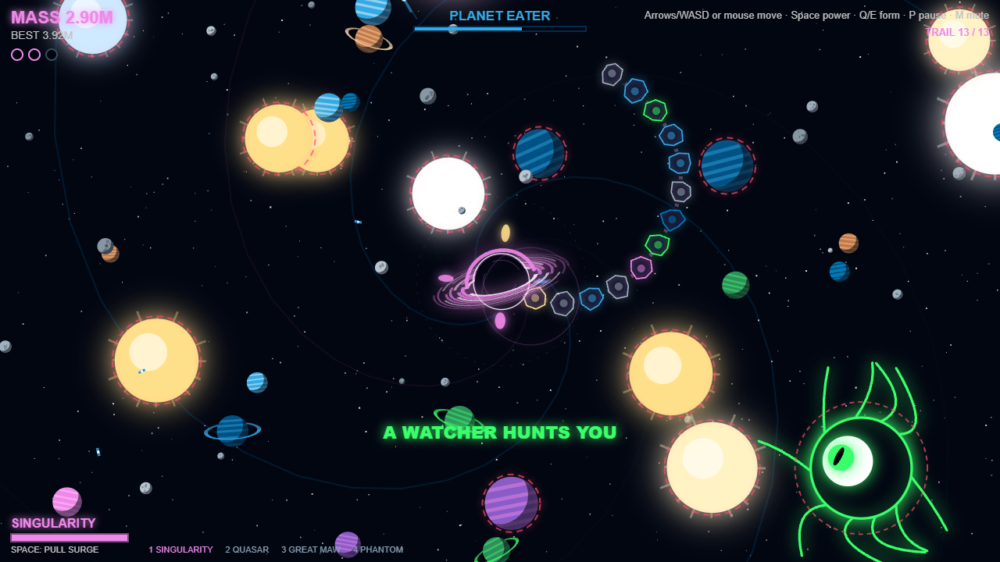
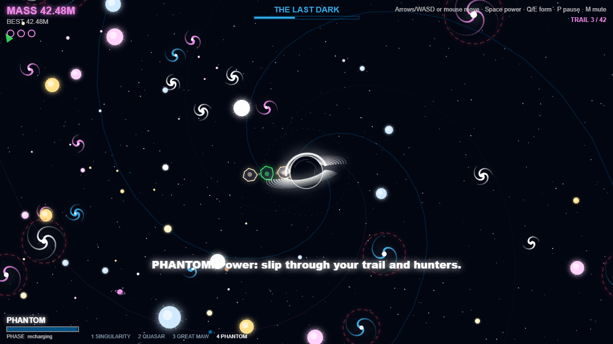
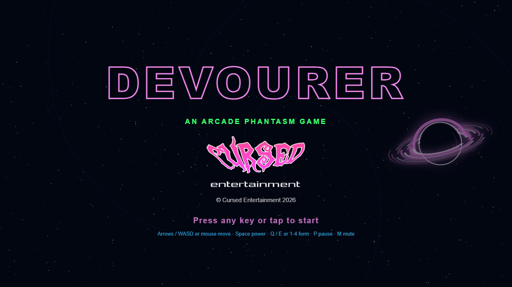

 

  

 

  
  
  

 

# DEVOURER

**An [Arcade Phantasm](https://arcade-phantasm.netlify.app/) game** · **[Play it](https://cursedprograms.github.io/Devourer/)** in your browser, on a computer or a phone.

You're a tiny black hole. Eat asteroids, satellites, moons and stars, grow, and finally swallow whole planetary systems while hostile celestial creatures hunt you and the screen falls into chaos.

**The twist:** Your size decides what you can eat, but bigger is slower, and the matter you've swallowed trails behind you and gets in your way.

## Versions

Every version of the game lives in this repo.

| Version | Where | Status |
| --- | --- | --- |
| Browser | the repo root · [play it](https://cursedprograms.github.io/Devourer/) | this one, playable now |
| Windows exe | `cpp/` | coming |
| Android | `android/` | coming |

## How to play

- **Eat anything smaller than you.** Get close and it's pulled in, spirals round you, stretches and is gone, and you grow. The dotted ring round you is the reach of your pull.
- **Anything bigger than you is deadly**: it's outlined in pulsing **warning red**. Touch it and you're torn: you lose a life, a fifth of your mass and half your trail. Three lives.
- **Bigger is heavier.** The more you weigh, the slower you move and the longer you take to turn and stop.
- **The camera pulls back as you grow**, through seven scales: The Belt (rocks) · Low Orbit (satellites, comets) · Moonfall · Planet Eater · Starving (stars) · System Collapse (whole planetary systems: eat the star and its planets come loose) · The Last Dark (galaxies), and on.
- **From Planet Eater on, what you swallow trails behind you** as a chain of debris that follows your path. It's solid: you can't pass through your own trail, and the bigger you get the longer it grows, so your own body becomes the thing in your way. Hunters that crash into it shatter into food.
- **Hunters** come for you: **Void Eels** (long serpents that never stop), **Comet Hounds** (they circle, flare white, then lunge) and **Watchers** (eyes that keep their distance and spit acid bigger than you). A hunter smaller than you is a meal.
- **Forms** unlock as you climb. Each has its own speed, pull and power (Space):
  - **Singularity**: balanced. Power: a pull surge (double reach, much stronger).
  - **Quasar**: fast, weaker pull. Power: a dash.
  - **Great Maw**: slow, huge pull. Power: a shockwave that throws hunters and their spit away and stuns them.
  - **Phantom**: power: phase through your own trail and the hunters for a moment.
- The longer and bigger you go, the worse it gets: more hunters, meteor showers, a vortex in the sky, the screen flickering and shaking.
- Your score is the mass you've eaten; the best is saved in the browser.

## Controls

| Key | Does |
| --- | --- |
| Arrows or WASD | move |
| Mouse (hold the button) | move towards the pointer |
| Space | your form's power |
| Q / E or 1-4 | change form |
| P | pause |
| M | mute |
| Space or R | begin again after you collapse |

**On a phone:** drag anywhere to move towards your finger; **POWER**, **FORM** and **II** (pause) are on the right.

## The files

Plain HTML5 canvas and JavaScript, no frameworks and no build step: open `index.html` or serve the folder.

| File | What it is |
| --- | --- |
| `index.html` | the page: canvas, splash, touch buttons |
| `site/style.css` | the page styling, in the Cursed colours |
| `site/game.js` | the game: the hole, eating and growth, the zooming camera, the trail, systems, hunters, forms, chaos |
| `site/sfx.js` | every sound, made with the Web Audio API (no audio files) |
| `images/` | the Cursed logo and the screenshots |

Add `#shot` to the URL for a frozen moment at the Planet Eater scale (it's how the screenshots are made).

## Also in the arcade

[KillerStardust](https://github.com/CursedPrograms/KillerStardust) · [ProtocolHex](https://github.com/CursedPrograms/ProtocolHex) · [Seance](https://github.com/CursedPrograms/Seance) · [RicochetReaper](https://github.com/CursedPrograms/RicochetReaper) · [GraveDanger](https://github.com/CursedPrograms/GraveDanger) · [Vortex](https://github.com/CursedPrograms/Vortex) · [Orbit](https://github.com/CursedPrograms/Orbit) · [RocksOfRuin](https://github.com/CursedPrograms/RocksOfRuin) · Devourer

 

© Cursed Entertainment 2026

 

